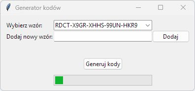
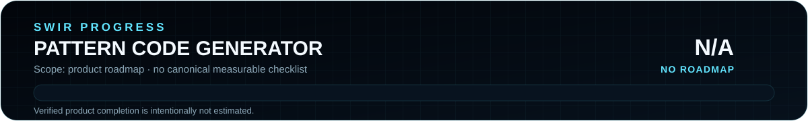

<!-- SWIR-README-STANDARD:v2 -->

<div align="center">


<br>


[](https://github.com/Swir)
[](https://github.com/Swir/keygenerator/stargazers)

[**Highlights**](#-highlights) · [**Quick Start**](#-quick-start) · [**Usage**](#-usage) · [**Releases**](#-releases)

</div>

## 📸 Screenshot — earlier interface



Initial code generator window on Windows.

<p align="center">
  
</p>

**Product roadmap progress:** N/A — this repository does not contain a canonical checklist or weighted roadmap from which software completion can be reproduced.


## 📍 Project Status

| Item | Status |
|---|---|
| Current stage | Stable small desktop utility |
| Platform | Windows release; Python/Tk source |
| Current source | 1.1.0 |
| Windows download | [Latest verified release](https://github.com/Swir/keygenerator/releases/latest) |
| Main purpose | Generate synthetic strings that preserve a selected template shape |
| Product roadmap | No canonical measurable roadmap |

## 🚀 Overview

**Pattern Code Generator** is a lightweight Tkinter desktop utility for producing synthetic strings based on reusable templates. Alphabetic and numeric characters are varied while separators and overall format are preserved. Users can save custom patterns to JSON, generate batches of ten variants, compare them with the source template and copy individual results.

The repository name is historical. The application is a **template-shaped random/test-data generator**; it does not create, recover, validate or activate genuine commercial software licenses, access tokens, credentials or other authorization secrets.

<div align="center">

</div>

## ✨ Highlights

| Feature | What it does |
|---|---|
| 🧩 Template selection | Uses saved string formats as generation patterns. |
| ➕ Custom patterns | Validates user-defined patterns and saves them atomically in the current user’s application-data folder. |
| 🔟 Batch generation | Produces ten variants per run in the current GUI. |
| 📊 Similarity score | Shows positional similarity between each generated value and the chosen template. |
| 🏆 Best match | Highlights the generated value with the highest similarity in the batch. |
| 📋 Clipboard | Copies a selected synthetic value directly from the GUI. |
| 🧩 Safe UI updates | Bounded generation of ten short codes stays on the Tk main thread, without background widget access. |

## ⚙️ Quick Start

### Recommended — Windows release

Download the verified public release:

[**Latest verified Windows release →**](https://github.com/Swir/keygenerator/releases/latest)

New releases provide `Key-Generator.exe`, a Windows x64 ZIP, `SHA256SUMS.txt`, build provenance and packaged-runtime verification. See [CHANGELOG.md](CHANGELOG.md) for 1.1.0 changes.

### From source

```bash
git clone https://github.com/Swir/keygenerator.git
cd keygenerator
python generator.py
```

The source uses Python's standard-library modules plus Tkinter. Your Python installation must include Tk support.

## 📋 Requirements / Compatibility

- Python 3 with Tkinter when running from source.
- Windows x64 for the published packaged executable/ZIP.
- Write access to `%LOCALAPPDATA%/Swir/PatternCodeGenerator` on Windows for saved patterns.
- When no user-profile store exists, a legacy `patterns.json` in the working directory can be read. Subsequent saves go to the user profile and leave the original file unchanged.

## 🎮 Usage

1. Select an existing pattern or type a new one.
2. Add the custom pattern if you want it saved.
3. Click **Generate codes**.
4. Review the ten generated variants and their similarity values.
5. Select a result and choose **Kopiuj wybrany kod** (Copy selected code).

Patterns contain 1–128 printable ASCII characters and at least one letter or digit. Up to 500 patterns are supported. Corrupt JSON is reported and preserved in a uniquely named backup before recovery; a failed save does not replace the previous file.

The generator preserves non-alphanumeric separators and varies nearby alphabetic/numeric characters around the source pattern. Similarity is a simple positional comparison; it is not a validity, license or cryptographic score.

## 🧠 Technology / Architecture

| Layer | Technology / role |
|---|---|
| GUI | Tkinter / ttk |
| Generation | Python `random` with template-character transforms |
| Pattern storage | Validated JSON, atomic replacement, corrupt-file backup and read-only legacy import |
| Packaging | GitHub Actions Windows release workflow |

## 🗺️ Roadmap

<p align="center">
  
</p>

No authoritative product roadmap is currently present. The progress graphic therefore reports **N/A** instead of treating the v1.0.0 release or file count as software completion.

## 📦 Releases

Current source: **1.1.0**. Download the [latest verified public release](https://github.com/Swir/keygenerator/releases/latest).

Regression tests, frozen application checks and verification of the freshly downloaded draft package gate publication. Public releases are never overwritten.

[**Browse GitHub Releases →**](https://github.com/Swir/keygenerator/releases)

## ⚠️ Limitations / Responsible Use

- Generated strings are synthetic test data derived from user-selected patterns.
- A high similarity score only means more characters match the template in the same positions.
- The tool does not query activation servers, reverse engineer licensing systems, validate credentials or bypass access controls.
- Do not present generated strings as genuine licenses, credentials or authorization secrets.

## 🧪 Verification

```powershell
python -m unittest discover -s tests -v
python generator.py --self-test generator-self-test.json
```

The self-test uses an isolated temporary pattern store and a hidden window; it exercises Add and Generate without changing user patterns or clipboard contents.

## 🔎 Search Keywords

`random code generator python` • `pattern string generator` • `template based test data` • `Tkinter random generator` • `synthetic serial format generator` • `JSON pattern generator` • `desktop code generator` • `batch random strings` • `template similarity score` • `Windows Python utility`


<div align="center">

### `DEFINE • GENERATE • COMPARE • COPY`

⭐ **If this project is useful, consider leaving a star.**

[**← SWIR profile**](https://github.com/Swir) · [**All projects →**](https://github.com/Swir?tab=repositories)

</div>
